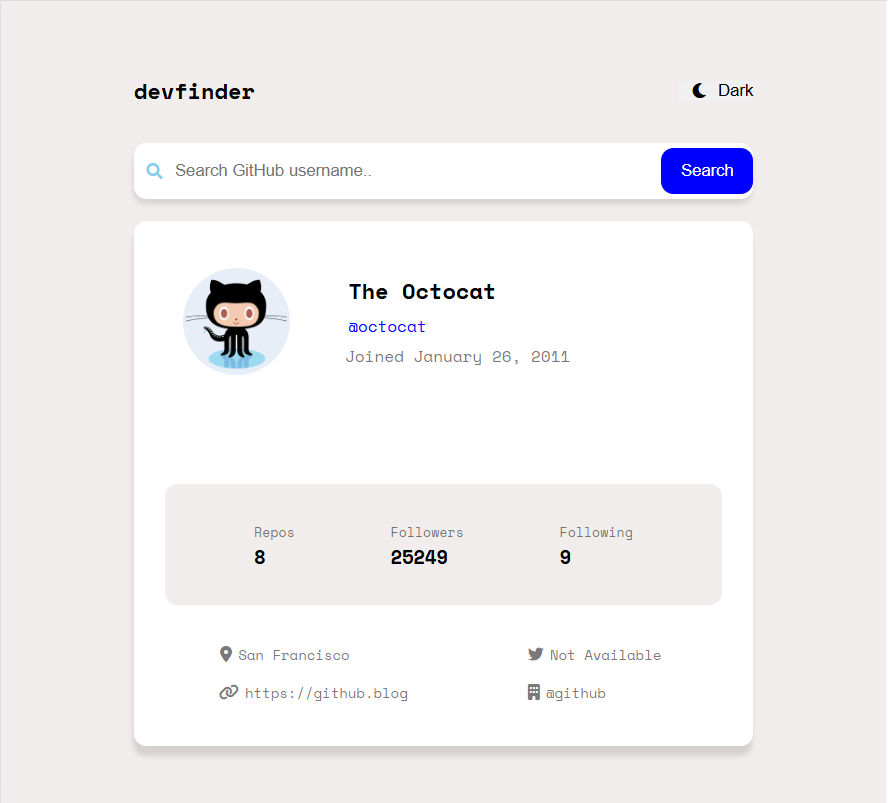

# devfinder
A GitHub user search app. Type a username and see their profile: avatar, bio, join date, repos, followers, following, location, blog, twitter, and company.
Based on a Frontend Mentor challenge, built from scratch with vanilla HTML, CSS, and JavaScript.

[Live Site🔗](https://gamrichmarak-jpg.github.io/github-user-search/)

# Desktop view

# Tablet view

# Mobile view

## Features
- Search any GitHub username through the GitHub API
- Dark and light mode, remembered after you reload
- Clear messages for user not found, invalid usernames, and no internet
- Search button is disabled while fetching data to prevent duplicate submissions
- Responsive layout for desktop, tablet, and phone

## Built with
HTML, CSS (Grid and Flexbox), JavaScript (fetch, async/await), GitHub REST API

## What I learned
Learned to validate input with a regex before calling the API. Testing showed that .. got collapsed into a different endpoint, so I only allow letters, numbers, and
hyphens, up to 39 characters.

## Known limitations
- The GitHub API allows 60 requests per hour without a token, so heavy testing can hit the limit.
